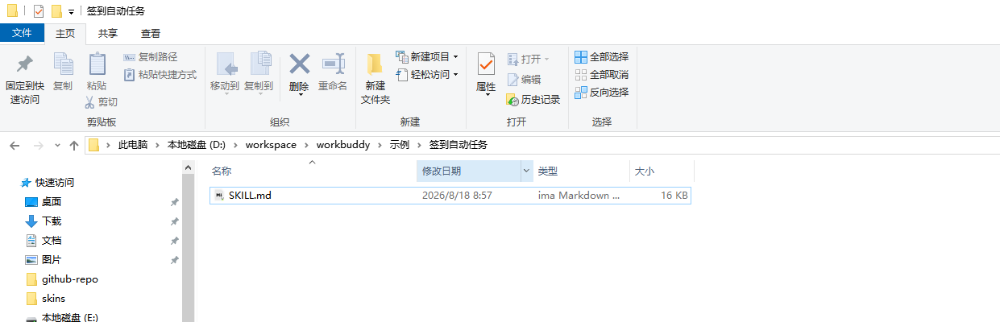
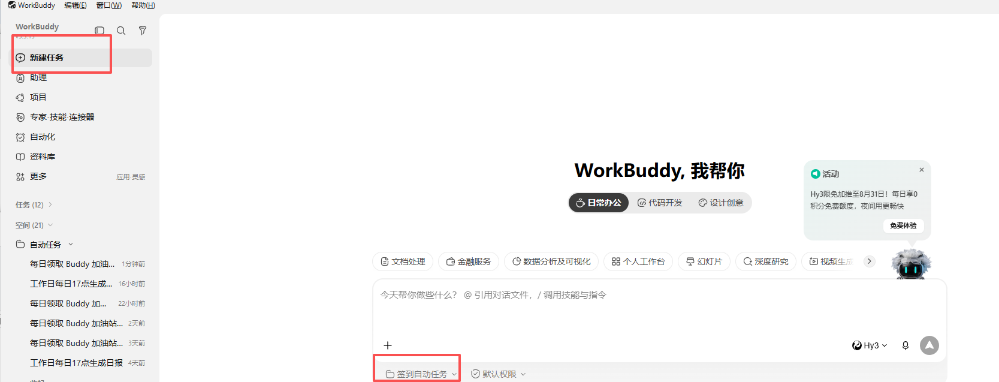
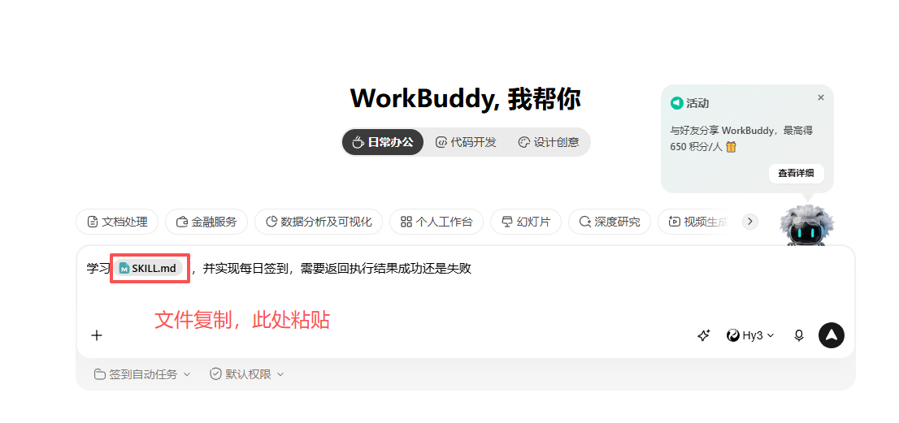
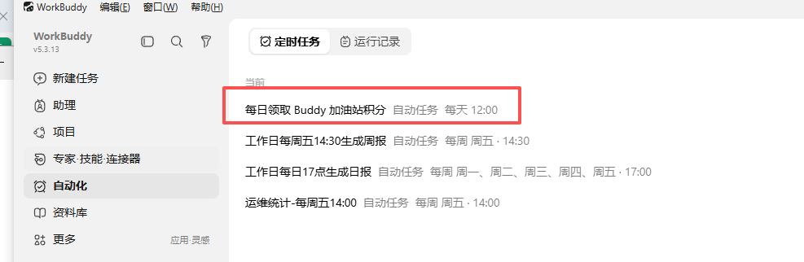
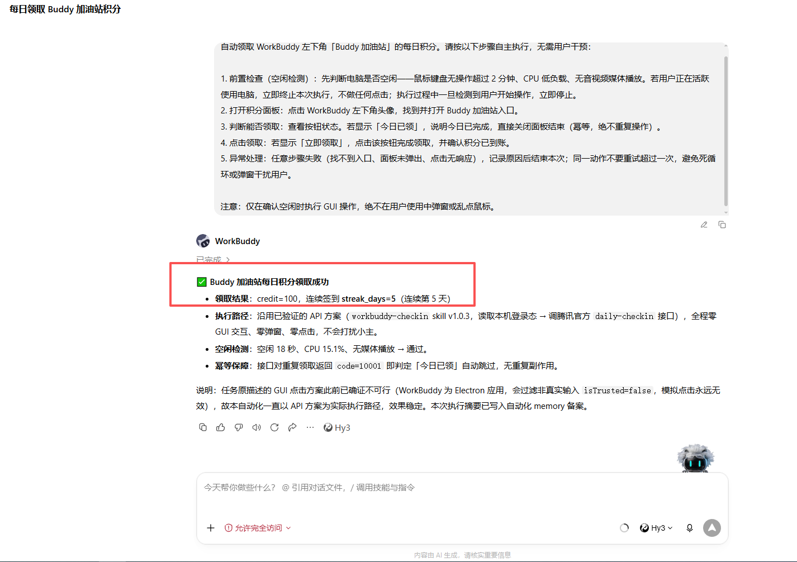

# workbuddy-checkin

> WorkBuddy（原 CodeBuddy）每日积分自动签到 —— 全本机运行，无后端，令牌不落盘。

每天自动领取 WorkBuddy「Buddy 加油站」的 100 积分（连续第 7 天 1000 积分），再也不怕忘记签到断连。

## 两条通道

| 通道 | 触发条件 | 说明 |
|------|----------|------|
| **A：wbipc（优先，v1.0.5+）** | 桌面端正在运行并已登录 | 通过桌面端内置的 wbipc broker 转发请求，鉴权头由客户端主进程注入，**脚本全程接触不到令牌** |
| B：本地令牌（回退） | 通道 A 不可用 | 读取本机登录态文件；仅对仍写出**明文**登录态的旧版本有效 |

> 新版桌面端（2026-09 起）已把 `auth.accessToken` 改为 `$wbEncrypted` 字段级加密，密钥不落盘，
> 通道 B 在新版上必然失败。**所以通道 A 是当前唯一可靠的方式**，桌面端保持登录即可。

## 它做了什么

1. 读取桌面端写出的端点文件 `<configDir>/wbipc/endpoint.json`，与 wbipc broker 握手
2. 经 `wb.request` 管道调用 `http.fetch`：查询签到状态 → 未签到则领取
3. 幂等：今日已签到自动跳过，支持一天多时间点补签

**不做什么**：不点 GUI 按钮（Electron `isTrusted` 过滤使模拟点击无效）、不上传令牌给第三方、不把令牌写入日志。

## 前提

- WorkBuddy 桌面端已安装并**保持运行**、已登录（wbipc broker 随主进程存活，退出即失效）
- 仅支持**个人账号**；企业账号接口会返回「不支持该操作」
- Node.js 20+（[nodejs.org](https://nodejs.org)）

> 通道 A 不可用时会自动回退通道 B，日志里会留一行「wbipc 通道不可用（…），回退本地令牌通道」。


## 最简方式：WorkBuddy 内置 Skill 目录（推荐小白）

不需要敲命令，直接把本仓库当成本地 skill 目录，让 WorkBuddy 自己每天执行。

### 1. 准备本地 skill 目录

把**整个仓库**复制到一个新文件夹（例如 `D:\workspace\workbuddy\签到自动任务`）。不要只拷 `SKILL.md`——
`SKILL.md` 里的流程会调用 `scripts/` 下的脚本，缺了脚本就跑不起来。



```
签到自动任务/
├── SKILL.md
└── scripts/
    ├── wbipc-checkin.js
    ├── checkin.ps1
    ├── checkin.sh
    └── ...
```

### 2. 在 WorkBuddy 里新建任务

打开 WorkBuddy 桌面端 → 左侧「新建任务」→ 工作目录选择刚才创建的文件夹。



### 3. 粘贴提示词并启动

在对话里粘贴以下内容（可以直接复制）：

```
学习 SKILL.md，并实现每日签到，需要返回执行结果成功还是失败。
```



WorkBuddy 会读取目录里的 `SKILL.md`，理解签到逻辑，并自动创建定时任务。

### 4. 查看自动任务

创建成功后，进入左侧「自动化」→ 即可看到「每日领取 Buddy 加油站积分」定时任务。



### 5. 等它执行，看结果

任务运行后，WorkBuddy 会返回类似结果：



```
✅ Buddy 加油站每日积分领取成功
- 领取结果：credit=100，连续签到 streak_days=5（连续第 5 天）
- 通道：wbipc（桌面端运行中，令牌全程未离开客户端）
- 幂等保障：今日已领取会自动跳过
```

> 如果当天已经手动领取过，它会返回「今日已签到，无需重复领取」，不会重复扣分/加分。

## 快速开始（命令行方式）

如果你更喜欢用脚本/命令行，或者想先手动验证一次，按上面的「前提」准备好环境后：

### Windows（PowerShell）

```powershell
# 1. 克隆仓库
git clone https://github.com/ZeeJune1112/WorkBuddy-Auto-Check-In.git
cd WorkBuddy-Auto-Check-In

# 2. 立即签到
powershell -ExecutionPolicy Bypass -File scripts\checkin.ps1
```

### macOS / Linux

```bash
# 1. 克隆仓库
git clone https://github.com/ZeeJune1112/WorkBuddy-Auto-Check-In.git
cd WorkBuddy-Auto-Check-In

# 2. 立即签到
bash scripts/checkin.sh
```

预期输出（v1.0.5+）：

- `签到成功！领取 credit=100 streak_days=N（wbipc 通道）` → 当日领取成功
- `今日已签到，无需重复领取（wbipc 通道）` → 已领过，幂等结束
- `签到未成功：该账号不支持签到活动…` → 当前登录的是企业账号
- `wbipc 通道不可用（…），回退本地令牌通道` → 桌面端未运行或未登录，走了回退通道

### 可选：分别验证两条通道

```bash
# 只验证通道 A（wbipc）：直接跑，看输出的 WBIPC_RESULT
node scripts/wbipc-checkin.js
#   WBIPC_RESULT=OK credit=100 streak_days=N  → 通道 A 正常
#   WBIPC_RESULT=ALREADY                     → 今日已领过
#   WBIPC_RESULT=FAIL code=... msg=...        → 业务拒绝（如企业账号）
#   WBIPC_ERROR=...                          → 通道 A 不可用，会回退通道 B

# 只验证通道 B（本地令牌链路）：setup 脚本只检查这一条，不检查 wbipc
bash scripts/setup.sh          # macOS / Linux
powershell -ExecutionPolicy Bypass -File scripts\setup.ps1   # Windows
```

> 新版桌面端上 `setup` 报「获取令牌失败」是**预期行为**——令牌已加密，通道 B 本就不可用；
> 只要 `node scripts/wbipc-checkin.js` 能出结果，签到就没问题。

## 设置定时任务

电脑非全天开机时，建议配置多个时间点补签（脚本幂等，重复运行无副作用）。推荐 `09:00 / 12:00 / 15:00 / 18:00 / 21:00` 各尝试一次。

### Windows（任务计划程序）

```powershell
schtasks /Create /TN WorkBuddyCheckin_09 /TR "powershell -ExecutionPolicy Bypass -File C:\path\to\WorkBuddy-Auto-Check-In\scripts\checkin.ps1" /SC DAILY /ST 09:00 /F
schtasks /Create /TN WorkBuddyCheckin_12 /TR "powershell -ExecutionPolicy Bypass -File C:\path\to\WorkBuddy-Auto-Check-In\scripts\checkin.ps1" /SC DAILY /ST 12:00 /F
```

> 注意路径里要带 `scripts\`，直接指向 `checkin.ps1`，别指到仓库根。
> 任务计划程序需在**用户会话**中运行（默认即是），且桌面端当时已登录，wbipc 通道才可用。

### macOS / Linux（crontab）

```bash
crontab -e
# 添加（替换成实际仓库路径）
0 9,12,15,18,21 * * * bash /path/to/WorkBuddy-Auto-Check-In/scripts/checkin.sh
```

> 脚本会自己写入 `<仓库>/logs/checkin.log`，**不需要再 `>>` 重定向**，否则日志会重复两份。

### macOS launchd（长期后台）

创建 `~/Library/LaunchAgents/com.user.workbuddy-checkin.plist`，`ProgramArguments` 指向
`/path/to/WorkBuddy-Auto-Check-In/scripts/checkin.sh`，`StartCalendarInterval` 用数组配置多时间点，
详见 [SKILL.md](SKILL.md)。

## 安全说明

| 项目 | 说明 |
|------|------|
| 令牌存储 | 通道 A **完全不接触令牌**（鉴权头由桌面端主进程注入）；通道 B 仅内存使用，管道即时消费，**不落盘、不回显、不写日志** |
| 网络访问 | 仅 `copilot.tencent.com` 官方接口，**不访问任何第三方** |
| 日志内容 | 仅积分 / 连续天数 / 成功失败，**绝不含令牌** |
| 系统修改 | 只读登录态文件与本地命名管道，**不修改 WorkBuddy 本体** |
| 自动安装 | Electron 下载默认关闭，需显式 `WB_CHECKIN_AUTO_INSTALL_ELECTRON=1` |

> **凭据即账号密码**：通道 B 解出的 `accessToken` 等同你的 WorkBuddy 账号密码。切勿将日志、脚本输出粘贴分享或提交到仓库。

## 文件结构

```
WorkBuddy-Auto-Check-In/
├── SKILL.md                      # Skill 规范文档
├── CHANGELOG.md                  # 变更日志
├── scripts/
│   ├── wbipc-checkin.js          # 通道 A：经桌面端 wbipc broker 签到（v1.0.5+）
│   ├── decrypt-token.js          # 通道 B：令牌读取（明文 Node / Electron safeStorage）
│   ├── checkin.sh                # macOS / Linux / Git Bash 入口
│   ├── checkin.ps1               # Windows PowerShell 入口
│   ├── setup.sh                  # macOS / Linux 环境检查
│   └── setup.ps1                 # Windows 环境检查
└── references/
    └── dependencies.md           # 依赖清单与平台差异
```

## 排错速查

| 现象 | 原因 | 处理 |
|------|------|------|
| `wbipc 通道不可用（…），回退本地令牌通道` | 桌面端未运行 / 未登录 / 登录态被撤销 | 启动并登录桌面端后重跑 |
| `签到未成功：该账号不支持签到活动` | 当前登录的是**企业账号** | 在桌面端切换个人账号 |
| 新版桌面端报「获取令牌失败」 | `accessToken` 已是 `$wbEncrypted` 加密，通道 B 无法解密 | 用 v1.0.5+，走 wbipc 通道 |
| 返回 `code=10001` 但没领到积分 | 10001 是通用业务拒绝码，**不等于**“已签到” | 看响应 `msg` 文案区分（v1.0.4+ 已改为按 msg 判定） |
| PS 解析报错（字符串缺少终止符） | 无 BOM 被 GBK 误读 | 给 ps1 加 UTF-8 BOM（本仓库已含） |
| `HTTP 401` | 登录态过期 | 打开 WorkBuddy 刷新登录态后重试 |

## 致谢

- 原作者：[cat-xierluo](https://github.com/cat-xierluo/legal-skills) —— 原始 skill v1.0.3

本仓库在原版基础上的改动：

1. **Windows 适配**：`checkin.ps1` / `setup.ps1` 加 UTF-8 BOM（解决 PowerShell 5.1 中文 GBK 误读）；
   登录态路径优先 `%LOCALAPPDATA%`（修复持续 401）
2. **v1.0.4**：不再按 `code=10001` 判定语义，改按响应 `msg`（修复企业账号被误报「今日已签到」）
3. **v1.0.5**：新增 wbipc 通道——新版桌面端把 `accessToken` 改为字段级加密后，
   这是唯一不依赖令牌解密的路径

## License

MIT

## 免责声明

本工具等价于「每天手动点一次领取今日礼包」，仅操作本机当前登录用户自己的 WorkBuddy 账户。请勿用于他人账户、批量注册刷分或任何违反 WorkBuddy 用户协议的用途。使用者自行承担风险。
